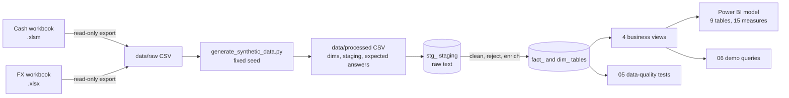

# Architecture

A small, readable pipeline: two existing Excel workbooks feed a SQL layer; the SQL layer is tested; Power BI reads the SQL views. It is a portfolio project, not a data warehouse.



## Layers

| Layer | Objects | Purpose |
|---|---|---|
| Source | the two workbooks (unchanged) | the business rules and the structure to follow |
| Raw | `data/raw/*.csv` | what the workbooks contain, exported read-only |
| Processed | `data/processed/*.csv` | dimensions, staging rows (with planted dirty rows) and the expected answers the tests compare with |
| Staging | `stg_cashflow`, `stg_fx_payment`, `stg_ap_schedule`, `stg_invoice` | raw text exactly as received; nothing is lost here |
| Work | `wrk_*` | cleaned, typed copies; source on every run |
| Core | `dim_*`, `ref_*`, `fact_cashflow`, `fact_opening_balance`, `fact_fx_payment`, `fact_payment_exception`, `fact_payment_control`, `rejected_record` | keys, constraints, one stated grain per table |
| Views | `vw_cash_position_daily`, `vw_cash_forecast_variance`, `vw_fx_payment_control`, `vw_payment_exception_summary` | the logic Power BI shows |
| Tests | `05_data_quality_tests.sql` and the Python checks | 47 SQL tests per engine |

## Grain of every fact

| Table | One row per |
|---|---|
| `fact_cashflow` | one Actual or Forecast cash-flow line (entity, currency, category, date) |
| `fact_opening_balance` | entity (balance before the first day) |
| `fact_fx_payment` | payment instruction |
| `fact_payment_exception` | payment and failed rule |
| `fact_payment_control` | payment (check flags and the primary exception) |
| `vw_cash_position_daily` | entity and calendar day |
| `vw_cash_forecast_variance` | month, entity, currency, category |

## Two engines, one set of rules

SQL Server (T-SQL) is the primary target. SQLite is the portable copy, so anyone can run the project with Python alone. Only the parsing step (`TRY_CONVERT`, `TRIM`, text concatenation) differs between the two; `scripts/build_sqlite_scripts.py` writes `sql/sqlite/*` from `sql/sqlserver/*` plus one hand-written dialect file (`scripts/sqlite_03_dialect.sql`), so the business rules exist once. Both engines produce identical exception results (cross-check in `tests/test_results.md`).

## Design decisions worth knowing

- **Staging before facts.** A row that cannot be loaded is rejected with a reason, not dropped.
- **LEFT JOIN where a missing match is information** (unmatched vendor), INNER JOIN only on keys that must exist.
- **Aggregate before you join** (flows per day, amounts per month): no fan-out.
- **A single place for each rule.** The control rules are written once (`03_transform.sql`, section C6); the flags and the primary exception are derived from the same helper view.
- **Independent oracle.** A second implementation of the payment rules in Python produces the expected answers; the SQL has to agree on all 150 payments, and for the 34 workbook payments the answers also come from the original Excel check sheet.
- **Power BI adds measures only.** Relationships are one-to-many, single direction; no bidirectional filters, no many-to-many, no fact-to-fact joins.

## How to run

```
powershell -NoProfile -ExecutionPolicy Bypass -File scripts\run_all.ps1            # everything
powershell -NoProfile -ExecutionPolicy Bypass -File scripts\run_all.ps1 -SkipSqlServer   # Python and SQLite only
python scripts/run_sqlite.py                                                         # SQLite only, no other software
```

Requirements: Python 3 (standard library only). Optional: SQL Server (Express is enough) for the T-SQL run; Power BI Desktop for the report.
