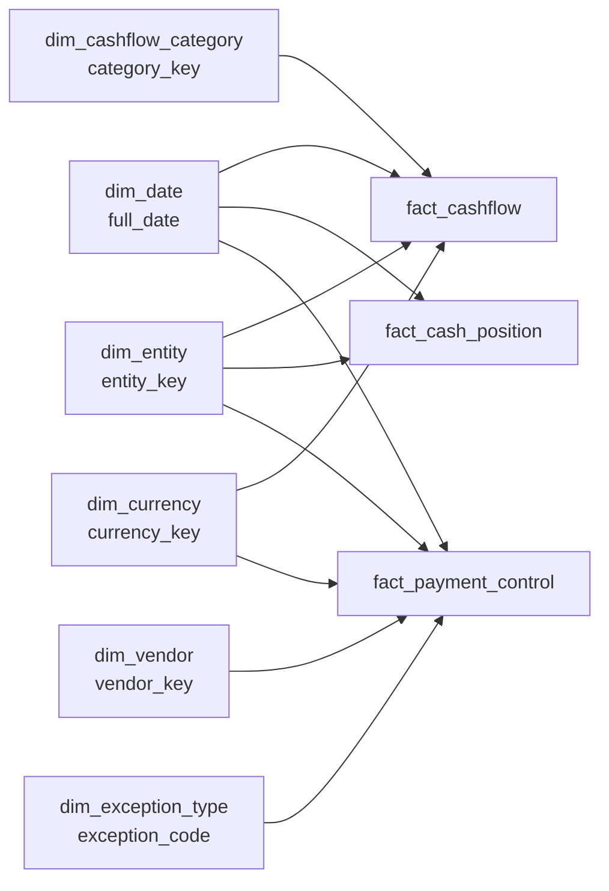

# Relationship map

All relationships are **many-to-one, single direction (dimension filters fact), active**. Each dimension reaches each fact table on exactly one path, so there is no ambiguity and no bidirectional filtering. Fact tables are never joined to each other.

| # | From (many) | To (one) | Notes |
|---:|---|---|---|
| 1 | `fact_cashflow[entity_key]` | `dim_entity[entity_key]` | |
| 2 | `fact_cashflow[currency_key]` | `dim_currency[currency_key]` | |
| 3 | `fact_cashflow[category_key]` | `dim_cashflow_category[category_key]` | |
| 4 | `fact_cashflow[transaction_date]` | `dim_date[full_date]` | date to date |
| 5 | `fact_cash_position[entity_key]` | `dim_entity[entity_key]` | |
| 6 | `fact_cash_position[full_date]` | `dim_date[full_date]` | |
| 7 | `fact_payment_control[entity_key]` | `dim_entity[entity_key]` | |
| 8 | `fact_payment_control[currency_key]` | `dim_currency[currency_key]` | |
| 9 | `fact_payment_control[vendor_key]` | `dim_vendor[vendor_key]` | 3 payments have no vendor key (blank): they stay in the report under "(Blank)" |
| 10 | `fact_payment_control[payment_date]` | `dim_date[full_date]` | |
| 11 | `fact_payment_control[exception_code]` | `dim_exception_type[exception_code]` | the PRIMARY exception; payments without an exception have a blank code |

Why this shape

- **One date table** (`dim_date`) for all date analysis; mark it as the date table on `full_date`.
- **One currency table** for all currency analysis. `fact_cash_position` has no currency (it is JPY), so there is no relationship 'position -> currency' and no risk of a second path.
- **No bidirectional filters, no many-to-many**: slicers on a dimension filter the facts; a slicer on a fact never filters a dimension.
- **Unmatched keys are kept**: `fact_payment_control[vendor_key]` is empty for three payments. Power BI shows them under a blank vendor, which is the intended behaviour (the SQL layer deliberately uses `LEFT JOIN`).

Checked on the model engine: slicing `Total Actual` by entity and by currency adds up to the total (`model_check_results.csv`).
